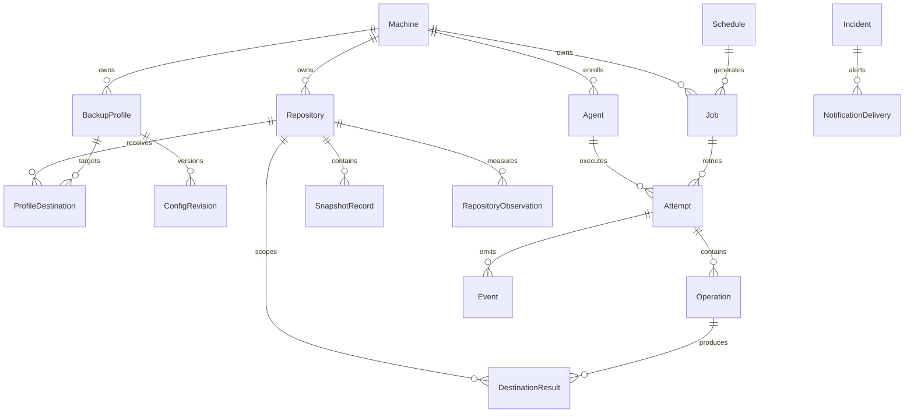

# Modèles, relations et invariants

Projet en conception — NON PRÊT POUR LA PRODUCTION. Modèle conceptuel proposé, pas un schéma PostgreSQL définitif.

Le [glossaire](14-glossaire.md) précise les termes. Les exigences publiées restent prioritaires ; les nouvelles cardinalités sont proposées pour lever les ambiguïtés, pas automatiquement acceptées.

## 1. Graphe principal

Lecture : || signifie exactement un, o{ signifie zéro à plusieurs. Le diagramme ne montre pas toutes les relations optionnelles et contraintes ; voir les tables suivantes.

## 2. Identités, propriété et configuration

| Relation | Cardinalité proposée / invariant |
|---|---|
| Machine -> Agent | 0..N enrôlements historiques ; au plus un agent actif autorisé par défaut, remplacement explicite. |
| Machine -> BackupProfile | 0..N ; chaque profil a exactement un propriétaire machine. |
| Machine -> Repository | 0..N ; chaque dépôt a exactement un propriétaire, sans partage inter-machines. |
| BackupProfile -> ProfileDestination | 1..N pour un profil exécutable ; exactement un primaire et 0..N destinations de réplication. |
| ProfileDestination -> Repository | Exactement un dépôt ; propriétaire identique à celui du profil. |
| Repository -> BackupProfile | 0..N profils d'une même machine via les destinations ; mutualisation intra-machine encore à ratifier. |
| BackupProfile -> ConfigRevision | 1..N après création ; révisions immuables, au plus une courante. |
| ConfigRevision -> FileSet/HookDefinition/RetentionPolicy | Composition immuable de la configuration ; toute modification crée une révision. Objets embarqués ou tables normalisées à décider. |

Les références de secrets ne donnent pas automatiquement accès aux valeurs. Les credentials de repository et l'identité REST de l'agent ont des cycles distincts. Une suppression administrative ne doit pas effacer l'historique : archivage/logical deletion proposé.

## 3. Programmations et cibles

Une Schedule appartient à une machine et cible exactement un périmètre compatible avec son type : profil pour backup, sélection profil/repository pour forget, repository pour prune/check/stats. Le schéma doit interdire les combinaisons invalides ; éviter un target_id opaque sans contrôle d'intégrité.

Schedule -> Job : 0..N occurrences historiques. Job -> Schedule : 0..1 ; un lancement manuel peut ne pas avoir de programmation.

PlanningRevision décrit l'ensemble distribué à un agent. Un même Job peut figurer dans plusieurs versions successives du planning ; cela ne crée pas plusieurs jobs. Une tâche remplacée ou annulée garde une trace.

MaintenanceWindow cible exactement une machine, un profil ou un repository ; début, fin éventuelle, motif et auteur. Son interprétation et priorité doivent être explicites. Une suspension n'est pas un nouvel objet de sauvegarde et ne détruit pas les résultats précédents.

## 4. Jobs, tentatives et étapes

Un Job appartient à une machine et porte type, origin, scheduled_at éventuel, références de configuration et cible. Job -> Attempt : 0..N ; zéro avant démarrage, plusieurs après retries. Une tentative a exactement un agent exécutant et un numéro unique dans son job.

PROPOSITION : distinguer catégorie du job et commande de l'étape. Un job backup composite comprend pre-hooks, commande backup primaire, commandes copy et post-hooks. forget/prune/check/stats sont des jobs autonomes. Une copy seule peut aussi être un job de reprise, lié au snapshot source et au backup d'origine, sans nouvelle lecture des sources.

Attempt -> Operation : 0..N étapes ordonnées ; chaque étape possède type, timestamps, état et code éventuel. Un HookResult dépend d'une étape hook ; un DestinationResult d'une étape Restic ciblant un dépôt. Pour copy, enregistrer source et destination explicitement.

JobDependency relie un job dépendant à un prérequis : relation N..N dirigée, acyclique, condition explicite de succès/fin. Une dépendance impossible doit être signalée, pas laisser un job attendre indéfiniment.

Le job conserve son résultat agrégé, la tentative son résultat et chaque étape son résultat. Ne pas confondre succès du primaire et succès global ; la table d'agrégation reste ouverte.

## 5. Snapshots et réplication

SnapshotRecord appartient à un repository. Clé métier proposée : repository_id + restic_snapshot_id ; l'ID Restic seul n'est pas une identité globale du modèle.

Un résultat backup peut produire 0..1 snapshot : absence de changement possible. Pour la rétention, une association JobSnapshot permet qu'un job référence plusieurs présences de snapshots, notamment primaire et replicas, et qu'un snapshot soit référencé par plusieurs jobs réussis sans nouvelle création.

Chaque association distingue rôle created, reused ou replicated et résultat de provenance. Une relation ReplicationLink relie présence source et présence destination, avec l'opération de copy. Les IDs ne sont pas supposés identiques.

Les repositories source/destination doivent avoir la même machine propriétaire. Un snapshot découvert sans association fiable reste unknown/unmanaged pour la purge proposée. Un snapshot supprimé du dépôt conserve une trace de métadonnées tant que nécessaire à l'audit et à la rétention.

PROPOSITION : indexer aussi profil/job par tags Restic stables pour la réconciliation ; les tags ne sont ni une ACL ni une preuve suffisante de succès.

## 6. Métadonnées, incidents et utilisateurs

Attempt -> Event : 0..N ; event_id unique et séquence définie. Les heartbeats d'agent sont distincts des événements d'exécution. Les résultats doivent rester disponibles même si les événements détaillés sont purgés.

RepositoryObservation appartient à un repository et possède collecteur, instant, mode et scope. Elle peut référencer un profil ou une sélection de snapshots. Une observation peut couvrir plusieurs snapshots ; ne pas en faire un compteur de volume à cumuler sans sémantique.

Incident cible une ressource précise et peut regrouper plusieurs occurrences/events. NotificationDelivery appartient à une notification d'incident ou de synthèse ; un envoi de synthèse n'a pas nécessairement un incident unique. La relation Incident du diagramme illustre le cas d'alerte, pas tous les envois.

Operator et Role ont une relation N..N proposée. Identité OpenLDAP et rôles applicatifs sont distincts ; l'authentification ne suffit pas à autoriser l'action. AuditEvent référence auteur humain ou système et ressource, sans credentials.

ServerExport possède demandeur/origine, dates, état, version de format et manifeste. C'est un objet serveur, pas un job attribué à une machine cliente ; un moteur commun de tâches peut être partagé sans confondre les propriétaires.

## 7. Invariants à imposer

- Propriétaire unique d'un dépôt ; aucune destination/copy inter-machines.
- Révision historique immuable, conservation des références utiles.
- Identité d'occurrence unique ; retries et redistribution ne créent pas de doublons.
- Une seule exécution active autorisée par machine selon l'exigence actuelle ; les processus externes ne sont pas implicitement couverts.
- Expiration de lease différente d'arrêt confirmé.
- Aucun succès supposé à partir de snapshot_id ou de présence de fichiers.
- Pas de suppression destructive sans correspondance et règles de rétention valides.
- Pas d'inventaire des fichiers transmis au serveur ; FileSet n'est pas une télémétrie de fichiers.
- Annulation demandée distincte de canceled confirmé.

## 8. Questions à trancher avant SQL/API

Partage intra-machine des dépôts ; stockage local agent ; cardinalité des agents actifs lors d'un remplacement ; agrégation des copies/hooks ; stratégie de références historiques ; représentation SQL des cibles polymorphes ; reprise d'une copy comme job distinct ; granularité des hooks ; attribution des rôles OpenLDAP.

Le schéma PostgreSQL, les migrations et le contrat REST devront traduire ces invariants avec tests. Ce document ne valide pas les amendements encore en attente ni une implémentation.
