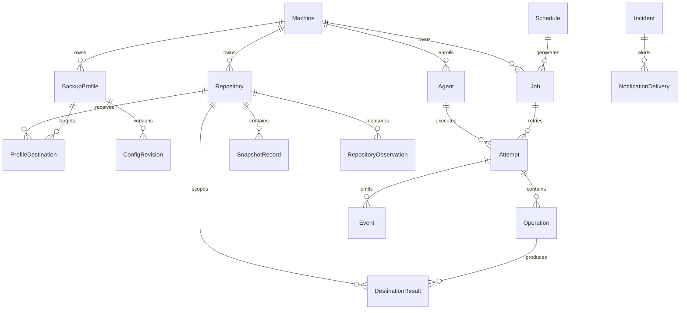

# Models, relationships, and invariants

Design phase — **NOT PRODUCTION READY**. This is a proposed conceptual model, not a definitive PostgreSQL schema.

See the [glossary](14-glossaire.md) for canonical terminology. Published requirements take precedence; proposed cardinalities clarify ambiguities but are not automatically accepted.

## 1. Main graph

In the diagram, || means exactly one and o{ means zero to many. The diagram does not show every optional relationship or constraint; see the tables below.

## 2. Identity, ownership, and configuration

| Relationship | Proposed cardinality / invariant |
|---|---|
| Machine -> Agent | 0..N historical enrollments; at most one active agent authorized by default, with explicit replacement. |
| Machine -> BackupProfile | 0..N; every profile has exactly one machine owner. |
| Machine -> Repository | 0..N; every repository has exactly one owner and is not shared across machines. |
| BackupProfile -> ProfileDestination | 1..N for an executable profile; exactly one primary and 0..N replication destinations. |
| ProfileDestination -> Repository | Exactly one repository; its owner matches the profile's owner. |
| Repository -> BackupProfile | 0..N profiles from the same machine through destinations; intra-machine sharing remains to be ratified. |
| BackupProfile -> ConfigRevision | 1..N after creation; revisions are immutable, with at most one current revision. |
| ConfigRevision -> FileSet/HookDefinition/RetentionPolicy | Immutable configuration composition; embedded objects versus normalized tables remain to be decided. |

Secret references do not automatically grant access to secret values. Repository credentials and the agent's REST identity have separate lifecycles. Administrative deletion must not erase history; archival/logical deletion is proposed.

## 3. Schedules and targets

A Schedule belongs to a machine and targets exactly one scope compatible with its type: a profile for backup, a profile/repository selection for forget, or a repository for prune/check/stats. The schema should forbid invalid combinations; avoid an opaque target_id without referential-integrity checks.

Schedule -> Job: 0..N historical occurrences. Job -> Schedule: 0..1; a manual launch may have no schedule.

PlanningRevision describes the set distributed to an agent. A Job may appear in multiple successive planning versions; this does not create multiple jobs. A replaced or canceled task retains a record.

MaintenanceWindow targets exactly one machine, profile, or repository, with start, optional end, reason, and author. Its interpretation and precedence must be explicit. A suspension does not create another backup object or delete previous results.

## 4. Jobs, attempts, and operations

A Job belongs to a machine and carries type, origin, optional scheduled_at, configuration references, and target. Job -> Attempt: 0..N; zero before start, multiple after retries. An attempt has exactly one executing agent and a unique number within its job.

PROPOSAL: distinguish job category from operation command. A composite backup job contains pre-hooks, the primary backup command, copy commands, and post-hooks. forget/prune/check/stats are standalone jobs. A copy alone may also be a recovery job linked to its source snapshot and original backup, without rereading sources.

Attempt -> Operation: 0..N ordered steps; each has type, timestamps, state, and optional code. A HookResult belongs to a hook operation; a DestinationResult belongs to a Restic operation targeting a repository. For copy, record source and destination explicitly.

JobDependency links a dependent job to a prerequisite: a directed N..N relation, acyclic, with an explicit completion/success condition. An impossible dependency must be reported rather than leaving a job waiting indefinitely.

The job stores its aggregate result, the attempt its result, and each operation its result. Do not confuse primary success with overall success; aggregation remains open.

## 5. Snapshots and replication

SnapshotRecord belongs to a repository. Proposed business key: repository_id + restic_snapshot_id; the Restic ID alone is not a globally unique model identity.

A backup result may produce 0..1 snapshot because no changes may have occurred. For retention, a JobSnapshot association allows a job to reference multiple snapshot presences, including primary and replicas, and a snapshot to be referenced by multiple successful jobs without a new creation.

Each association distinguishes created, reused, or replicated role and provenance result. A ReplicationLink connects source and destination snapshot presences with the copy operation. IDs are not assumed identical.

Source and destination repositories must have the same machine owner. A discovered snapshot with no reliable association remains unknown/unmanaged for the proposed purge. A deleted snapshot retains metadata as long as needed for audit and retention.

PROPOSAL: also index stable profile/job tags in Restic for reconciliation; tags are neither an ACL nor sufficient proof of success.

## 6. Metadata, incidents, and users

Attempt -> Event: 0..N; event_id is unique and sequencing is defined. Agent heartbeats are distinct from execution events. Results must remain available even if detailed events are purged.

RepositoryObservation belongs to a repository and has a collector, timestamp, mode, and scope. It may reference a profile or snapshot selection. An observation may cover multiple snapshots; do not treat it as a volume counter to accumulate without defined semantics.

An Incident targets a specific resource and may group multiple occurrences/events. NotificationDelivery belongs to an incident notification or summary; a summary delivery need not have a single incident. The Incident edge in the diagram illustrates alerting, not every delivery.

Operator and Role have a proposed N..N relationship. OpenLDAP identity and application roles are distinct; authentication alone does not authorize an action. AuditEvent references a human or system actor and a resource, without credentials.

ServerExport has requester/origin, timestamps, state, format version, and manifest. It is a server object, not a job owned by a client machine; an execution engine may be shared without conflating ownership.

## 7. Invariants to enforce

- A repository has one owner; no cross-machine destination/copy.
- Historical revisions are immutable and useful references are retained.
- Occurrence identity is unique; retries and redistribution do not create duplicates.
- Only one active execution is authorized per machine under the current requirement; external processes are not implicitly covered.
- Lease expiration is not confirmed process termination.
- Never infer success from snapshot_id or file presence.
- No destructive deletion without reliable mapping and valid retention rules.
- No file inventory is sent to the server; FileSet is not file telemetry.
- A cancellation request is distinct from confirmed cancellation.

## 8. Questions to resolve before SQL/API

Intra-machine repository sharing; agent-local storage; number of active agents during replacement; aggregation of copies/hooks; historical-reference strategy; SQL representation for polymorphic targets; retrying a copy as a separate job; hook granularity; OpenLDAP role mapping.

The PostgreSQL schema, migrations, and REST contract must implement these invariants with tests. This document does not approve pending amendments or claim an implementation.
