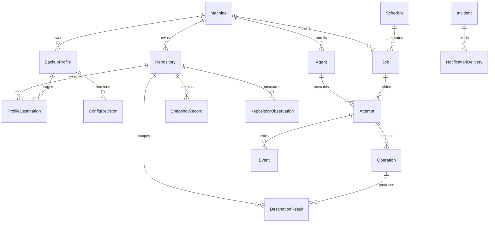

# Modèles, relations et invariants

Phase de conception — **NON PRÊT POUR LA PRODUCTION**. Il s’agit d’un modèle conceptuel proposé, pas d’un schéma PostgreSQL définitif.

Consulter le [glossaire](14-glossaire.md) pour la terminologie canonique. Les exigences publiées prévalent ; les cardinalités proposées clarifient les ambiguïtés sans être automatiquement acceptées.

## 1. Graphe principal

Dans le diagramme, `||` signifie exactement un et `o{` signifie zéro à plusieurs. Le diagramme ne montre pas toutes les relations facultatives ni toutes les contraintes ; voir les tableaux ci-dessous.

## 2. Identité, propriété et configuration

| Relation | Cardinalité / invariant proposé |
|---|---|
| Machine -> Agent | 0..N enrôlements historiques ; par défaut, au plus un agent actif autorisé, avec remplacement explicite. |
| Machine -> BackupProfile | 0..N ; chaque profile a exactement une machine propriétaire. |
| Machine -> Repository | 0..N ; chaque repository a exactement un propriétaire et n’est pas partagé entre machines. |
| BackupProfile -> ProfileDestination | 1..N pour un profile exécutable ; exactement un primaire et 0..N destinations de réplication. |
| ProfileDestination -> Repository | Exactement un repository ; son propriétaire correspond à celui du profile. |
| Repository -> BackupProfile | 0..N profiles de la même machine via les destinations ; le partage intra-machine reste à ratifier. |
| BackupProfile -> ConfigRevision | 1..N après création ; révisions immuables, avec au plus une révision courante. |
| ConfigRevision -> FileSet/HookDefinition/RetentionPolicy | Composition de configuration immuable ; objets intégrés ou tables normalisées à décider. |

Les références de secrets n’accordent pas automatiquement l’accès aux valeurs des secrets. Les credentials des repositories et l’identité REST de l’agent ont des cycles de vie distincts. La suppression administrative ne doit pas effacer l’historique ; l’archivage/suppression logique est proposé.

## 3. Schedules et cibles

Un Schedule appartient à une machine et cible exactement un périmètre compatible avec son type : un profile pour le backup, un choix profile/repository pour forget, ou un repository pour prune/check/stats. Le schéma doit interdire les combinaisons invalides ; éviter un `target_id` opaque sans contrôles d’intégrité référentielle.

Schedule -> Job : 0..N occurrences historiques. Job -> Schedule : 0..1 ; un lancement manuel peut ne pas avoir de schedule.

PlanningRevision décrit l’ensemble distribué à un agent. Un Job peut apparaître dans plusieurs versions successives de planification sans créer plusieurs jobs. Une tâche remplacée ou annulée conserve un enregistrement.

MaintenanceWindow cible exactement une machine, un profile ou un repository, avec début, fin facultative, motif et auteur. Son interprétation et sa priorité doivent être explicites. Une suspension ne crée pas un autre objet backup et ne supprime pas les résultats antérieurs.

## 4. Jobs, tentatives et opérations

Un Job appartient à une machine et porte un type, une origine, un `scheduled_at` facultatif, des références de configuration et une cible. Job -> Attempt : 0..N ; zéro avant démarrage, plusieurs après retries. Une tentative a exactement un agent d’exécution et un numéro unique dans son job.

**PROPOSITION :** distinguer catégorie de job et commande d’opération. Un job backup composite contient pre-hooks, commande de backup primaire, commandes copy et post-hooks. `forget`/`prune`/`check`/`stats` sont des jobs autonomes. Une copy seule peut aussi être un job de reprise lié à son snapshot source et au backup d’origine, sans relire les sources.

Attempt -> Operation : 0..N étapes ordonnées ; chacune a type, timestamps, état et code facultatif. Un HookResult appartient à une opération hook ; un DestinationResult appartient à une opération Restic ciblant un repository. Pour copy, enregistrer explicitement source et destination.

JobDependency relie un job dépendant à un prérequis : relation orientée N..N, acyclique, avec condition explicite d’achèvement/réussite. Une dépendance impossible doit être signalée plutôt que de laisser un job en attente indéfiniment.

Le job stocke son résultat agrégé, la tentative son résultat et chaque opération son résultat. Ne pas confondre réussite primaire et réussite globale ; l’agrégation reste ouverte.

## 5. Snapshots et réplication

SnapshotRecord appartient à un repository. Clé métier proposée : `repository_id` + `restic_snapshot_id` ; l’ID Restic seul n’est pas une identité de modèle globalement unique.

Un résultat de backup peut produire 0..1 snapshot car aucun changement n’a pu survenir. Pour la rétention, une association JobSnapshot permet à un job de référencer plusieurs présences de snapshot, notamment primaire et réplicas, et à un snapshot d’être référencé par plusieurs jobs réussis sans nouvelle création.

Chaque association distingue rôle créé, réutilisé ou répliqué, ainsi que le résultat de provenance. Un ReplicationLink relie les présences source et destination au moyen de l’opération copy. Les IDs ne sont pas supposés identiques.

Les repositories source et destination doivent avoir le même propriétaire machine. Un snapshot découvert sans association fiable reste inconnu/non géré pour la purge proposée. Un snapshot supprimé conserve ses métadonnées aussi longtemps que nécessaire à l’audit et à la rétention.

**PROPOSITION :** indexer également des tags Restic stables de profile/job pour la réconciliation ; les tags ne sont ni une ACL ni une preuve suffisante de réussite.

## 6. Métadonnées, incidents et utilisateurs

Attempt -> Event : 0..N ; `event_id` est unique et la séquence est définie. Les heartbeats agent sont distincts des événements d’exécution. Les résultats doivent rester disponibles même si les événements détaillés sont purgés.

RepositoryObservation appartient à un repository et possède un collecteur, timestamp, mode et périmètre. Il peut référencer un profile ou une sélection de snapshots. Une observation peut couvrir plusieurs snapshots ; ne pas traiter cela comme un compteur de volume à cumuler sans sémantique définie.

Un Incident cible une ressource précise et peut regrouper plusieurs occurrences/événements. NotificationDelivery appartient à une notification d’incident ou à un récapitulatif ; une livraison de récapitulatif peut ne pas avoir d’incident unique. L’arête Incident du diagramme illustre l’alerte, pas chaque livraison.

Operator et Role ont une relation N..N proposée. L’identité OpenLDAP et les rôles applicatifs sont distincts ; l’authentification seule n’autorise pas une action. AuditEvent référence un acteur humain ou système et une ressource, sans credentials.

ServerExport possède demandeur/origine, timestamps, état, version de format et manifeste. C’est un objet serveur, pas un job appartenant à une machine cliente ; un moteur d’exécution peut être partagé sans confondre la propriété.

## 7. Invariants à faire respecter

- Un repository a un seul propriétaire ; aucune destination/copy inter-machine.
- Les révisions historiques sont immuables et les références utiles sont conservées.
- L’identité d’occurrence est unique ; retries et redistributions ne créent pas de doublons.
- Une seule exécution active est autorisée par machine selon l’exigence actuelle ; les processus externes ne sont pas couverts implicitement.
- L’expiration d’un lease ne confirme pas l’arrêt du processus.
- Ne jamais déduire la réussite de `snapshot_id` ou de la présence de fichiers.
- Aucune suppression destructive sans correspondance fiable et règles de rétention valides.
- Aucun inventaire de fichiers n’est transmis au serveur ; FileSet n’est pas de la télémétrie de fichiers.
- Une demande d’annulation est distincte d’une annulation confirmée.

## 8. Questions à résoudre avant SQL/API

Partage de repositories intra-machine ; stockage local agent ; nombre d’agents actifs lors d’un remplacement ; agrégation des copies/hooks ; stratégie de références historiques ; représentation SQL de cibles polymorphes ; retry d’une copy comme job distinct ; granularité des hooks ; mapping des rôles OpenLDAP.

Le schéma PostgreSQL, les migrations et le contrat REST doivent implémenter ces invariants avec des tests. Ce document n’approuve pas les amendements en attente et ne revendique aucune implémentation.
